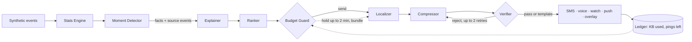
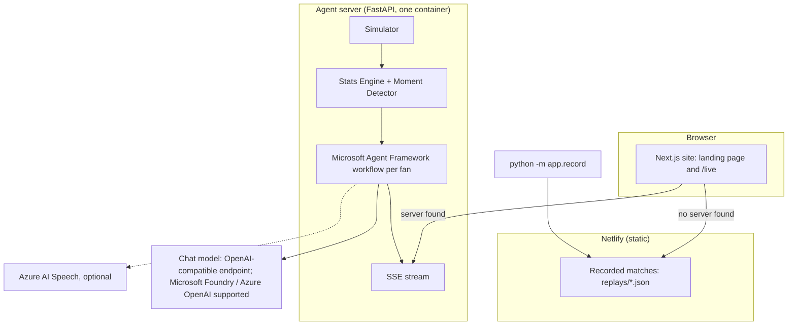

# MatchGist

[](https://github.com/softalpha0/MatchGist/actions/workflows/ci.yml)

**One match, told to each fan in the way that fits their channel, their data budget and their language.**

A football match reaches millions of people at once, but the rich version of it only works for someone on fast
data, in English, watching a screen. Everyone else gets a scoreline. A commuter in Jakarta on a 1 MB plan, a
student in Delhi reading Hindi on SMS, a fan roaming in Dubai with a watch: they get the same goal as a 160-character
afterthought, if at all. MatchGist turns a stream of synthetic match events into explained match intelligence,
then fits each moment to what each fan actually has, and shows the events behind every line it sends.

> Entry for the *Inside the Game* Developer Hackathon. All clubs, players, matches and fans are fictional. The
> match data is synthetic and generated by our own seeded simulator.

| | |
|---|---|
| Live app | `<your Netlify URL>` (no login; open `/live`) |
| Sample match | `<your Netlify URL>/live`, pick **Late drama**, press **Kick off**, then **Jump → FT** |
| Demo video | `<YouTube link>` |
| Evidence | [`evidence/`](evidence/): moments, source events, outputs and Verifier results for four full matches |

In the four recorded matches, **193 messages** went to six fans. All 193 were written by the model and passed
the Verifier; 6 drafts were rejected (a number not in the facts, or too long for the SMS allowance) and fixed on
the Compressor's second try; **0** fell back to a template.

## Contents

1. [The problem](#the-problem)
2. [What MatchGist does](#what-matchgist-does)
3. [Try it in a minute](#try-it-in-a-minute)
4. [How it works](#how-it-works)
5. [Architecture](#architecture)
6. [Explainability](#explainability)
7. [What the model does, and what it never does](#what-the-model-does-and-what-it-never-does)
8. [Guarantees](#guarantees)
9. [Azure and Microsoft technology](#azure-and-microsoft-technology)
10. [Tech stack](#tech-stack)
11. [Running it yourself](#running-it-yourself)
12. [Testing](#testing)
13. [Project layout](#project-layout)
14. [Known limitations](#known-limitations)
15. [Build log](#build-log)
16. [Credits](#credits)

## The problem

Match intelligence products assume a big screen, fast Wi-Fi and English. Many fans have none of these during a
match. They follow at work, on a bus, on a basic phone, or abroad on expensive roaming data. For them, two hard
limits decide what is possible: how many bytes they can afford, and how many interruptions (pings) they will
accept. A third limit hides inside SMS: one Hindi or Arabic letter switches a message from 160 characters to 70.
A tool that writes one English paragraph and truncates it fails all of them.

## What MatchGist does

Each moment is detected from the events, explained once, and then fitted separately for every fan. Same goal,
six fans:

| Fan (fictional) | Channel | Limits | What arrives |
|---|---|---|---|
| Studio analyst, London | Broadcast overlay | none | Timed lower-third cue with xG and shot speed |
| Commuter, Jakarta | SMS, Bahasa | 1 MB, 4 pings, Riverside only | One GSM-7 segment (160 chars), 0.2 KB |
| Fan, Lagos | Voice note, Pidgin | 2 MB, 6 pings | About 5 seconds, about 10 KB |
| Student, Delhi | SMS, Hindi | 1.5 MB, follows player #10 | UCS-2: 70 characters per segment |
| Office worker, São Paulo | Push, Portuguese | 200 KB, 3 pings | 50-character title, 100-character body |
| Fan roaming in Dubai | Watch, Arabic | 300 KB, 5 pings | 40 characters plus one number |

Every message shows its size, its SMS segments and encoding, and a **why?** link to the events behind it.

## Try it in a minute

1. Open the live app and press **Watch it live**.
2. Pick **Late drama** and press **Kick off**. The match plays at 30x; switch to 120x if you like.
3. Watch the five devices fill up. Under each one: data used against the budget, pings left, and which limit
   binds.
4. Press **Jump → 85'** and watch the equaliser and the winner reach each fan differently. The Jakarta fan only
   follows Riverside, so the Northgate winner is skipped for them, and the System panel says why.
5. Tap **why?** under any message. You see the detected facts, the 6 source events (time, type, player, team,
   pitch coordinates), the Budget Guard's decision and every agent step for that fan.
6. Tap any **key moment** on the left for the same view of the moment itself.
7. At full time each fan gets a digest sized to whatever is left of their budget.

## How it works

1. **Simulate.** A seeded possession-chain simulator produces about 1,300 events per match: passes, carries,
   shots, tackles, pressure, possession changes, cards, substitutions.
2. **Interpret.** The Stats Engine computes possession, pass difficulty, xG, momentum and a pressure index. It is
   the only source of numbers.
3. **Detect.** The Moment Detector turns state changes into moments (goal, big chance, momentum swing, pressure
   spike, cards, half-time, full-time), each with a base score, the facts it may cite and its source events.
4. **Explain once.** The Explainer agent writes why the moment matters, in English, once for all fans.
5. **Fit per fan, in parallel.** Ranker → Budget Guard → Localizer → Compressor ⇄ Verifier → delivery.
6. **Recap.** At full time the Digest agent writes a recap sized to the fan's remaining budget.



## Architecture



The page checks for the agent server. If it finds one, it runs a live match through the agents. If not (the
Netlify site), it plays a recorded run of the same pipeline, made with `python -m app.record`. Both use the same
UI and the same data shapes.

## Explainability

Every message can be traced back to the events that produced it.

- **Detected facts and narrative are separate.** Facts come from deterministic code over the events
  (`backend/app/stats/`, `backend/app/moments/`). The model only writes words around them.
- **Every moment keeps its source events:** the trigger and the 5 events before it
  (`backend/app/moments/detector.py`, `source_event_ids`).
- **Every delivery keeps its moment IDs** (`backend/app/state/ledger.py`), so the UI walks message → moments →
  facts → events.
- **The Verifier checks every number.** Each digit in a message must appear in that moment's facts. Devanagari
  and Arabic-Indic digits are normalised first. A message that fails goes back to the Compressor with the exact
  reason, up to twice, then a deterministic template takes over (`backend/app/agents/verifier.py`).
- **Marked in the UI.** Each message shows "why? ✓ checked" (model text that passed) or "why? (template)".

```mermaid
sequenceDiagram
  participant D as Moment Detector
  participant C as Compressor (model)
  participant V as Verifier (code)
  participant F as Fan device
  D->>C: facts + localized text + channel limit
  C->>V: candidate message
  alt a number is not in the facts, or a limit is broken
    V->>C: exact reason, e.g. "SMS is 2 segments (82 UCS-2 units); allowance is 1"
    C->>V: second attempt
  end
  alt still failing
    V->>F: per-channel, per-language template
  else passes
    V->>F: message + moment IDs (why? opens facts and source events)
  end
```

## What the model does, and what it never does

| The model (Explainer, Localizer, Compressor, Digest) | Code only |
|---|---|
| Says why a moment matters, in 1-2 sentences | Simulates events; computes every statistic |
| Translates into the fan's language and tone | Detects moments and decides their facts |
| Shortens text to fit a channel limit | Decides send, hold, bundle or skip (Budget Guard) |
| Writes the full-time recap | Measures SMS segments, sizes, voice length; checks every number |
| | Falls back to templates; charges the ledger |

The model never computes a number, never decides whether a fan is pinged, and never has the last word on
whether a message fits.

## Guarantees

Only what the code enforces:

| Guarantee | How | Where |
|---|---|---|
| An SMS never exceeds the segment allowance the Budget Guard gave it | Real GSM-7 vs UCS-2 detection (160/153 vs 70/67), extension and surrogate pairs counted, never `len()` | `channels/sms_encoding.py`, `agents/verifier.py` |
| Watch, push, chat and voice limits are never exceeded | Checked before delivery; templates are fitted word by word | `channels/limits.py`, `agents/fallbacks.py` |
| Every digit in a delivered message appears in the moment's facts | Verifier, with digits from any script normalised | `agents/verifier.py` |
| A fan's ping limit and data budget are never exceeded | Ledger plus Budget Guard; the last 2 pings are kept for a goal and the digest | `state/ledger.py`, `agents/budget_guard.py` |
| The feed never stops | Every model call has a timeout and 2 retries; then a template | `agents/llm.py` |
| A public link can't run up model costs | Per-minute and per-day caps on model calls; over the cap, templates answer at once | `agents/llm.py` (`CallCap`) |
| Every moment can be traced to its events | Source event IDs stored on the moment, moment IDs on the delivery | `moments/detector.py`, `state/ledger.py` |

Paths are under `backend/app/`.

## Azure and Microsoft technology

| Technology | Status in this submission |
|---|---|
| **Microsoft Agent Framework** | Used. Each agent is an Agent Framework `Agent`; each fan's chain is a `WorkflowBuilder` graph with conditional edges and the Verifier → Compressor retry loop (`agents/orchestrator.py`). |
| Microsoft Foundry / Azure OpenAI | Supported in code (`agents/llm.py`) but **not used by the deployed demo**: we could not open an Azure subscription in time. The recorded runs used an OpenAI-compatible chat endpoint; the model is named in each recording and in the System panel. |
| Azure AI Speech | Adapter built (`voice/tts.py`); not configured in the demo, so voice notes show their transcript and estimated size. |
| Azure Container Apps | Deploy script and Dockerfile ready (`infra/deploy.ps1`, `docs/deploy.md`); not deployed. |
| GitHub Actions | Used: lint, tests, frontend build and a container smoke test on every push. |

The deployed site is static on Netlify and plays recorded runs. To run the agents live, start the FastAPI
server (below).

## Tech stack

| Layer | Choice |
|---|---|
| Agents | Microsoft Agent Framework 1.22 (Python) |
| Backend | Python 3.11+, FastAPI, Pydantic v2, Server-Sent Events |
| Frontend | Next.js 15 (static export), React 19, Tailwind CSS 4 |
| Model | Any OpenAI-compatible chat endpoint; Microsoft Foundry and Azure OpenAI clients included |
| Hosting | Netlify (static site and recordings); Docker image for the agent server |
| Quality | pytest, ruff, TypeScript, GitHub Actions |

## Running it yourself

Windows PowerShell. Backend:

```powershell
cd backend
py -3.12 -m venv .venv               # or the full path to python.exe
.\.venv\Scripts\Activate.ps1
pip install -e ".[dev]"
pytest -q
uvicorn app.main:app --reload        # http://127.0.0.1:8000
```

Frontend, in a second window:

```powershell
cd frontend
npm install
npm run build                        # FastAPI serves frontend\out at http://127.0.0.1:8000/
```

No keys are needed: without a model, the agents run on a deterministic offline backend with the same workflow.
To use a model, copy `.env.example` to `.env` (never committed):

| Variable | What it does |
|---|---|
| `MATCHGIST_LLM_BASE_URL` | OpenAI-compatible endpoint, e.g. `https://…/v1` |
| `MATCHGIST_LLM_API_KEY` | Its key |
| `MATCHGIST_LLM_MODEL` | Model name |
| `MATCHGIST_LLM_TIMEOUT` | Seconds per model call (default 8) |
| `MATCHGIST_LLM_CALLS_PER_MINUTE` / `_PER_DAY` | Caps on model calls; 0 means none. A goal triggers about 12 calls, so use 60+ per minute |
| `AZURE_OPENAI_ENDPOINT`, `AZURE_OPENAI_API_KEY`, `AZURE_OPENAI_DEPLOYMENT_FAST` | Azure OpenAI in Foundry instead |
| `AZURE_AI_PROJECT_ENDPOINT` | A Foundry project with Entra ID instead |
| `AZURE_SPEECH_KEY`, `AZURE_SPEECH_REGION` | Real voice notes |
| `MATCHGIST_OFFLINE` | `1` forces the offline backend |

`http://127.0.0.1:8000/config` shows which backend is active, without exposing keys.

**Record matches for the static site** (uses the model in `.env` if set):

```powershell
cd backend
python -m app.record                 # writes frontend\public\replays\*.json and evidence\*.md
```

**Deploy to Netlify:** connect the GitHub repo in Netlify. `netlify.toml` builds `frontend/` and publishes
`frontend/out`. No environment variables are needed.

## Testing

178 backend tests, all offline. Model calls are never made in tests: they use the offline client or test
doubles.

| Area | File | Tests | What they cover |
|---|---|---|---|
| Agents | `test_agents.py` | 102 | Templates in 6 languages, Budget Guard, Ranker, Verifier (a hallucinating model and a failing model), the Hindi SMS reject-and-rewrite loop, budget limits for every persona, call caps |
| Channels | `test_channels.py` | 32 | GSM-7 vs UCS-2, extension characters, surrogate pairs, limits, sizes |
| Simulator | `test_simulator.py` | 16 | Determinism, schema, realistic counts and scores, coordinates, storylines, pacing |
| Stats and moments | `test_stats.py` | 13 | Possession, pass difficulty, xG, momentum, moment rules |
| Stream | `test_stream.py` | 6 | SSE contents, late joiners, one shared playback, replay, ledger, digest, add a fan |
| API and recorder | `test_api.py` | 5 | Endpoints, replays in order, source events present, evidence |
| Data | `test_data.py`, `test_fans.py` | 4 | Fictional clubs and fan profiles are valid |

CI runs ruff, the tests, the frontend build and a container smoke test on every push
(`.github/workflows/ci.yml`).

## Project layout

| Path | What |
|---|---|
| `backend/app/simulator/` | Seeded match simulator, event schema, storylines |
| `backend/app/stats/`, `moments/`, `state/` | Stats Engine, Moment Detector, Match State and ledgers |
| `backend/app/channels/` | SMS encoding, channel limits, size model, overlay cues |
| `backend/app/agents/` | Explainer, Ranker, Budget Guard, Localizer, Compressor, Verifier, Digest, templates, workflow |
| `backend/app/record.py` | Records full matches for the static site and `evidence/` |
| `backend/app/voice/` | Azure AI Speech adapter |
| `frontend/` | Landing page and `/live` (Next.js + Tailwind) |
| `frontend/public/replays/` | Recorded matches played by the static site |
| `data/` | Fictional clubs and the six fan personas |
| `evidence/` | Generated trails for four matches |
| `docs/` | Hackathon brief, architecture, event schema, deploy guides, submission text |
| `infra/` | Azure Container Apps and Hugging Face deploy scripts |

## Known limitations

- **Synthetic data only.** Events come from our simulator, not real matches or video.
- **Channels are simulated.** No real SMS, push or watch messages are sent; sizes and segments are computed
  exactly, but delivery is shown on device mock-ups.
- **The Verifier checks digits, not words or names.** A number written as a word ("two-one") or a wrong player
  name would not be caught. The prompts require digits.
- **Languages:** English, Hindi, Bahasa Indonesia, Brazilian Portuguese, Arabic and Nigerian Pidgin. Template
  fallbacks exist for all six; model output was reviewed by eye, not by native speakers.
- **Model latency.** About 1-6 seconds per call; at high playback speeds live deliveries trail the pitch, and
  calls over the cap use templates. The recorded runs don't have this problem.
- **Not on Azure.** See [Azure and Microsoft technology](#azure-and-microsoft-technology).
- **The live server keeps matches in memory**, so it runs as one instance.

## Build log

- **Oct 21:** simulator, event schema, fan personas; Stats Engine, Moment Detector, SMS encoding, SSE stream;
  agents and the per-fan workflow; landing page and live demo.
- **Oct 21:** OpenAI-compatible model backend and call caps after Azure sign-up failed.
- **Oct 26:** first full runs with a live model; prompt fixes (SMS character budget, digits only); 30x default.
- **Oct 26:** source events on every moment, the **why?** evidence drawer, recorded matches and static replay
  for Netlify, phone layout, `evidence/`.

## Credits

- Built for the *Inside the Game* Developer Hackathon by Microsoft and the Premier League. No league or club
  logos, names or data are used.
- Microsoft Agent Framework, FastAPI, Pydantic, Next.js, React, Tailwind CSS.
- System fonts only; the icon is our own.
- Demo video narration: Piper text-to-speech with the LibriTTS-R voice (CC BY 4.0); music synthesised for the
  video, no samples.
- All clubs, players and fans are fictional. MIT licence.
