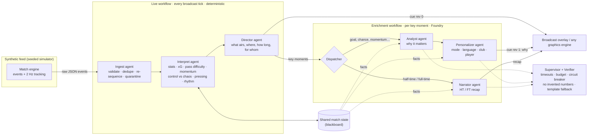

# Touchline

**A multi-agent engine that turns synthetic football events into explainable, personalised broadcast overlays.**

Touchline takes a live feed of synthetic match events and tracking data, works out what matters and *why*,
and hands a broadcast graphics engine timed, machine-readable overlay cues. The same intelligence is then
re-told differently for every viewer: a data-hungry analyst, a casual fan, a supporter of one club, someone
following one player, in English, Spanish, French or Portuguese.

Built for **Inside the Game: Developer Hackathon**, challenge *The Synthetic Match Insights Engine for Premier League Studio*.
It is built on **Microsoft Agent Framework** workflows, with the language agents running on **Microsoft Foundry**.

> Every club, player, venue and number in Touchline is fictional and generated by a seeded simulator.
> No real match data, footage, names or league branding is used.

---

## Try it

```bash
pip install -e ".[foundry]"    # Python 3.11+
touchline serve                # http://localhost:8000
```

The app runs with **no keys and no login**. Without Foundry settings, the language agents run on a
deterministic offline backend: the same agents, workflow, verifier and supervisor, but rendering
multilingual templates instead of calling a model. To run the agents on Microsoft Foundry:

```bash
export FOUNDRY_PROJECT_ENDPOINT="https://<resource>.services.ai.azure.com/api/projects/<project>"
export FOUNDRY_MODEL="gpt-4.1-mini"     # any chat model deployment in the project
az login                                 # DefaultAzureCredential
touchline serve
```

Useful URLs:

| URL | What |
|---|---|
| `/` | Live broadcast view: pitch, overlays, story feed, stats and Agent Ops |
| `/?seed=42&speed=16` | Replay a specific synthetic match at 16× |
| `/api/schema/cue` | JSON Schema of the overlay cue a graphics engine consumes |
| `/api/docs` | OpenAPI docs |
| `ws://…/ws/match` | The live cue stream (see [docs/CUE_FORMAT.md](docs/CUE_FORMAT.md)) |

There is also a headless mode that prints every cue as JSON lines:

```bash
touchline simulate --seed 7 --mode analyst --lang es
touchline simulate --seed 7 --events     # the raw synthetic event feed
```

### What to look at in the UI

1. **Fan ↔ Analyst** (keys `f` / `a`). This flips the whole experience: which moments make air,
   how dense the graphics are, the tone and detail of every explanation, and the stats panel. What's
   already on screen is re-rendered for the new profile.
2. **My club / Follow player / Language / Pinned metric.** Supporter framing ("Your club: GOAL…"),
   a persistent tag and stat card that follows one player all match, four languages, and one metric
   kept on screen.
3. **Agent Ops → Inject a fault.** Knock out the model, slow it down, make it invent a statistic,
   or corrupt the event feed. Watch the Verifier reject the invented number, the Supervisor time out,
   fall back and open the circuit breaker, and the Ingest agent repair or quarantine bad events,
   all while the broadcast carries on.
4. **Cue JSON.** The exact timed cues the overlays are drawn from.

---

## How it works



### The five required stages

| Stage | Where | What it does |
|---|---|---|
| **Ingest** | `touchline/sim/engine.py`, `touchline/agents/ingest.py` | A seeded simulator streams events (passes, carries, shots, tackles, interceptions, pressures, possession changes, fouls, cards, corners, saves, metadata) plus 2 Hz tracking for all 22 players. The Ingest agent treats it as an untrusted wire feed: it validates the schema, drops duplicates, re-sequences late events, clamps off-pitch coordinates and quarantines references to unknown players. |
| **Interpret** | `touchline/analytics/state.py`, `touchline/analytics/moments.py` | It maintains a shared match state covering possession, xG, pass completion, progressive passes, final-third entries, pressing rate, distance, sprints and top speed. Rolling indices give **momentum** (threat-weighted, decaying), **control vs chaos** (turnovers/min, passes per move, accuracy, fouls) and **rhythm** (actions/min, pass speed). Moment detection turns these into insights with facts attached. |
| **Explain** | `touchline/agents/roles.py`, `touchline/agents/pipeline.py` | The Analyst agent says *why* a moment matters (against the run of play? a 6% chance? a team trailing that has taken over?). It may only cite numbers from the facts, and the Verifier enforces that. |
| **Render** | `touchline/agents/director.py`, `docs/CUE_FORMAT.md` | The Director emits `OverlayCue`s with match-clock in and out times, a slot (`full_panel`, `lower_third`, `corner_bug`, `player_tag`, `pitch_arrow`, `ticker`), a priority, a player or pitch anchor, a headline and stat chips. Cues go out instantly with deterministic text, then the agents' explanation follows as `revision: 1`. A graphics engine never waits for a model. |
| **Personalize** | `touchline/agents/director.py`, Personalizer and Narrator agents | The profile is a mode (fan or analyst), a language, a favourite club, a focus player and a pinned metric. It changes which moments air (fans don't see every pass-difficulty graphic; a followed player's moments always air), their priority, the headline framing, the chips, and how the agents tell the story. |

### Agents and roles

| Agent | Kind | Responsibility |
|---|---|---|
| Ingest | Agent Framework `Executor` | Clean the feed. Every repair or quarantine is reported to Agent Ops. |
| Interpret | `Executor` | Update the shared state and detect key moments with their facts |
| Director | `Executor` | Editorial control: filter per profile, place and time cues, apply the screen budget (one lower-third at a time, priority pre-emption, goals and period ends always air) |
| Dispatcher | `Executor` + switch-case edge | Route recaps to the Narrator and everything else to the Analyst |
| Analyst | Agent Framework `Agent` on Foundry | Neutral English explanation of why the moment matters |
| Personalizer | `Agent` on Foundry | Adapt the explanation to one viewer (mode, language, club, player). Skipped when the draft already fits. |
| Narrator | `Agent` on Foundry | Half-time and full-time studio recap, including whether xG says the score is fair |
| Verifier | Guardrail | Reject output that cites a number not in the facts, is empty, or is too long for a cue |
| Supervisor | Guardrail | Timeout, per-session model budget, concurrency limit, circuit breaker, template fallback, full trace |

Fault injection goes through Agent Framework **agent middleware**, so outages, slow calls and
hallucinations hit the real Foundry path exactly as they hit the offline one.

### Why this design

- **Never block the broadcast on a model.** Cues are rendered deterministically, then enriched. If
  Foundry is slow or down, viewers still get correct graphics; they just get the template explanation.
- **Numbers come from state, words come from agents.** Detection and statistics are deterministic
  and tested. The language agents are only allowed to cite facts they were given, which a verifier
  checks. This targets the most damaging failure in sports graphics: a confidently wrong stat.
- **Cost-aware.** Model calls are only made for moments above an importance threshold (or for the
  followed player), with a per-session budget and concurrency cap. The Personalizer is skipped when
  the Analyst's draft already fits the viewer.

---

## The synthetic data

`touchline/sim/engine.py` is a seeded, physics-limited match simulator. It is football-realistic, not random:

- 4-3-3 team shapes that shift with a smoothed ball position, with the two nearest defenders pressing
  and receivers running onto passes. Movement is speed- and acceleration-limited, so players cover
  ~10–12 km with ~40 sprints and top out around 33–36 km/h.
- Passes follow an expected-completion model (distance, passing lane, pressure, passer quality). That
  probability *is* the pass difficulty rating, so the difficulty shown on screen is meaningful. Ball
  speed, accuracy and progressive-pass flags come with each pass.
- Shots use a distance and angle xG model (header and pressure penalties), with finishing skill,
  shot speed and outcomes (goal, saved, blocked, off target) plus corners, goal kicks and restarts.
- Club styles (possession, direct, pressing, balanced) and player ratings change how matches play out.
  A typical match has about 1,400 passes at ~80% completion, 15–40 shots and 0–6 goals.

The same seed always produces the same match, so every demo and test is reproducible.

---

## Deploy to Azure

Touchline ships as one container. The Bicep in `infra/` creates Azure Container Apps (managed identity,
Log Analytics, ACR, health probes, autoscale 1–3) and grants the app identity the *Azure AI User* role on
your Foundry account.

```bash
azd auth login
azd env new touchline
azd env set AZURE_LOCATION swedencentral
azd env set FOUNDRY_PROJECT_ENDPOINT "https://<resource>.services.ai.azure.com/api/projects/<project>"
azd env set FOUNDRY_MODEL "gpt-4.1-mini"
azd env set FOUNDRY_ACCOUNT_ID "/subscriptions/…/resourceGroups/…/providers/Microsoft.CognitiveServices/accounts/<resource>"  # same resource group
azd up
```

Leave the `FOUNDRY_*` values unset to deploy in offline mode. Guardrail settings (all optional):

| Variable | Default | Meaning |
|---|---|---|
| `TOUCHLINE_OFFLINE` | `false` | Force the offline backend even if Foundry is configured |
| `TOUCHLINE_LLM_TIMEOUT` | `8` | Seconds before the Supervisor abandons a model call |
| `TOUCHLINE_LLM_BUDGET` | `120` | Max model calls per viewer session |
| `TOUCHLINE_LLM_CONCURRENCY` | `4` | Concurrent model calls per session |
| `TOUCHLINE_LLM_MIN_IMPORTANCE` | `0.45` | Importance needed for a model call (the followed player always qualifies) |
| `TOUCHLINE_BREAKER_FAILURES` / `_COOLDOWN` | `3` / `30` | Circuit breaker |
| `TOUCHLINE_MAX_SESSIONS` | `40` | Concurrent viewers per replica |

---

## Development

```bash
pip install -e ".[dev,foundry]"
pytest -q            # simulator realism, analytics, verifier, supervisor, ingest, director, pipeline, websocket
ruff check . && ruff format --check . && mypy touchline
```

```
touchline/
  sim/          seeded match simulator and fictional clubs
  analytics/    shared match state, indices, key-moment detection
  agents/       ingest, director, language agents, supervisor/verifier, workflows, offline backend, templates
  server/       FastAPI app and per-viewer live sessions
web/            broadcast UI (vanilla JS + canvas, no build step)
infra/          Bicep for Azure Container Apps (+ Foundry role assignment)
docs/           architecture notes, cue format, submission material
```

## License

MIT. All clubs, players and data are fictional.
