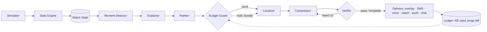

# MatchGist

**The match, sized to fit every fan.**

Most match-intelligence tools assume you watch on a big screen with fast Wi-Fi. Many fans don't. They follow on
mobile data, at work, on the bus, roaming abroad, or on a basic phone. MatchGist turns a live stream of
synthetic football events into explained match intelligence, then fits it to what each fan actually has: an
SMS, a short voice note, a watch glance, a push alert or a full broadcast overlay, in their language, within
their data budget and ping limit.

> Entry for Microsoft's *Inside the Game* Developer Hackathon. **All clubs, players, matches and fans are
> fictional. Synthetic data only.**

- **Live demo:** `<add your live URL>` (no login). Open `/live`, pick a storyline, press *Kick off*.
- **Demo video:** `<add the YouTube link>`

Same goal, six fans:

| Fan | Channel | What arrives |
|---|---|---|
| Studio analyst, London | Broadcast overlay | Timed overlay cue with xG and shot speed |
| Commuter, Jakarta (1 MB, 4 pings, Riverside only) | SMS, Bahasa | One GSM-7 segment, 0.2 KB |
| Fan, Lagos (2 MB, 6 pings) | Voice note, Pidgin | ~5 s note, ~10 KB |
| Student, Delhi (1.5 MB, follows #10) | SMS, Hindi | UCS-2: 70 characters per segment |
| Office worker, São Paulo (200 KB, 3 pings) | Push, Portuguese | 50-char title, 100-char body |
| Fan roaming in Dubai (300 KB, 5 pings) | Watch, Arabic | 40 characters plus one number |

## Architecture



Details in [docs/architecture.md](docs/architecture.md).

## Microsoft tech and where it's used

| Technology | Where |
|---|---|
| **Microsoft Agent Framework** | `backend/app/agents/`: `Agent`s for the Explainer, Localizer, Compressor and Digest; a `WorkflowBuilder` graph per fan with conditional edges and the Verifier→Compressor retry loop (`orchestrator.py`) |
| **Microsoft Foundry** | Hosts the chat model behind every language agent (`llm.py`: Azure OpenAI with a key, or a Foundry project with Entra ID). The same Agent Framework client also runs against any OpenAI-compatible endpoint, with per-minute and per-day call caps |
| **Azure AI Speech** | Neural text-to-speech voice notes over the REST API, with real Ogg/Opus duration and size (`voice/tts.py`) |
| **Azure Container Apps** | One container serving the API, the SSE stream and the web UI (`Dockerfile`, `infra/deploy.ps1`) |
| **GitHub Actions** | Lint, tests, frontend build, container smoke test, publish to GitHub Container Registry |

## Run locally (Windows PowerShell)

Backend (Python 3.11+). If `py` isn't recognised, use the full path to `python.exe`, as shown:

```powershell
cd backend
& "$env:LOCALAPPDATA\Programs\Python\Python312\python.exe" -m venv .venv    # or: py -3.12 -m venv .venv
.\.venv\Scripts\Activate.ps1          # if blocked: Set-ExecutionPolicy -Scope CurrentUser RemoteSigned
pip install -e ".[dev,foundry]"
pytest -q                             # 175 tests, all offline
uvicorn app.main:app --reload         # API on http://127.0.0.1:8000
```

Frontend (Node 20+; `winget install OpenJS.NodeJS.LTS`), in a second window:

```powershell
cd frontend
npm install
npm run build                         # static site into frontend\out; FastAPI then serves it
```

Restart `uvicorn` and open **http://127.0.0.1:8000/** (landing page) and **/live** (the demo).
For hot-reload while editing the UI, use `$env:NEXT_PUBLIC_API_BASE = "http://127.0.0.1:8000"; npm run dev` and
open http://localhost:3000.

**No keys needed.** Without Azure settings, the agents run on a deterministic offline backend: the same agents
and workflow, rendering multilingual templates. To use Foundry and Speech, copy `.env.example` to `.env` and fill
it in (see [docs/deploy.md](docs/deploy.md)). No Azure account? Any OpenAI-compatible free tier works, and the
app can be hosted on a free Hugging Face Space: see [docs/deploy-free.md](docs/deploy-free.md).
`http://127.0.0.1:8000/config` shows which backend is active.

Other useful commands:

```powershell
python -m app.simulator --seed 42 --storyline late_drama --out ..\matches\m001.jsonl
curl.exe -N http://127.0.0.1:8000/matches/demo-late_drama/stream
```

## API

| Method | Path | Purpose |
|---|---|---|
| POST | `/matches` | Simulate a match `{seed, speed, storyline}` |
| POST | `/matches/{id}/replay` | A fresh live run of an existing match (instant) |
| GET | `/matches` | Matches and their status |
| GET | `/matches/{id}/stream` | SSE: `snapshot`, `event`, `stats`, `moment`, `delivery`, `agent_event`, `fan_joined`, `end` |
| GET | `/matches/{id}/state` | Match State snapshot, moments, momentum series |
| POST | `/matches/{id}/fans` | Add a fan to a live match |
| GET | `/matches/{id}/fans/{fan_id}/ledger` | Everything sent to a fan, data used, pings left, binding limit |
| GET | `/matches/{id}/fans/{fan_id}/digest` | The full-time digest |
| GET | `/fans` | The six demo personas |
| GET | `/audio/{delivery_id}.ogg` | A synthesised voice note |
| GET | `/config`, `/health` | Active backends; health |

OpenAPI docs: `/api/docs`. Event schema and fan profile: [docs/event-schema.md](docs/event-schema.md).

## How the agents coordinate, decide and recover

- **Explained once, fitted per fan.** The Explainer writes "why it matters" once per moment. Every fan then runs
  their own workflow in parallel: Ranker → Budget Guard → Localizer → Compressor ⇄ Verifier → delivery.
- **The Budget Guard plans the whole match.** The send threshold rises as pings run out
  (`50 + 40 × (1 − pings_left / max_pings)`). Lesser moments never use the last two pings, which are kept for a
  goal and the full-time digest. Close moments are held for up to 2 match-minutes and bundled into one ping.
  Every decision is logged with its reason.
- **The order matters.** The Localizer runs before the Compressor, because translating changes length and one
  Hindi letter switches an SMS from 160 to 70 characters.
- **Recovery.** Every model call has an 8 s timeout and 2 retries. A Verifier rejection goes back to the
  Compressor with the exact reason (e.g. *"SMS is 2 segments (82 UCS-2 units); allowance is 1"*), up to twice,
  and a per-channel, per-language template takes over after that. The feed never stops.
- **Numbers are checked.** Every number in every message must appear in the moment's facts from the Stats Engine.
  Devanagari and Arabic-Indic digits are normalised first.

## Channel size model and SMS encoding

| Channel | Hard limit | Size estimate |
|---|---|---|
| SMS | 1–2 segments (digest up to 3) | 0.2 KB per segment |
| Chat | 280 characters | UTF-8 bytes + 1 KB |
| Voice | 15 seconds | Opus 16 kbps: seconds × 2 KB (real size once synthesised) |
| Watch | 40 characters, no digits, plus one value | UTF-8 bytes + 0.5 KB |
| Push | title 50, body 100 characters | UTF-8 bytes + 1 KB |
| Broadcast | overlay cue | not budgeted |

SMS length is measured with a real GSM-7 encoder check, never with `len()`:
- GSM-7 carries 160 characters in one segment and 153 per segment when concatenated. Extension characters
  (`€ [ ] { } ^ ~ | \`) take 2.
- A single character outside GSM-7 (Hindi, Arabic, most emoji, curly quotes, Portuguese ç/ã/ê) makes the whole
  message UCS-2: 70 characters, or 67 per segment. Emoji outside the BMP take 2.
- Escape pairs and surrogate pairs are never split across segments.
- For Latin-script languages the Compressor drops accents when that saves a segment, and says so in the System
  panel.

## Repo layout

| Path | What |
|---|---|
| `backend/app/simulator/` | Seeded match simulator, event schema, storylines |
| `backend/app/stats/`, `state/`, `moments/` | Stats Engine, Match State and ledger, Moment Detector |
| `backend/app/channels/` | SMS encoding, channel limits, size model, overlay cues |
| `backend/app/agents/` | Explainer, Ranker, Budget Guard, Localizer, Compressor, Verifier, Digest, templates, orchestrator |
| `backend/app/voice/` | Azure AI Speech adapter |
| `frontend/` | Next.js + Tailwind: landing page and live demo |
| `data/` | Fictional clubs (Riverside Athletic, Northgate Rovers) and the six personas |
| `docs/` | Architecture, event schema, deploy guide, progress |
| `infra/deploy.ps1` | Azure Container Apps deployment (PowerShell) |
| `infra/deploy-hf.ps1` | Free deployment to a Hugging Face Docker Space (PowerShell) |

## Statement

All clubs, players, matches and fans in MatchGist are fictional and generated by our own seeded simulator. No real
league data, footage, names, crests or branding are used.

MIT licence.
