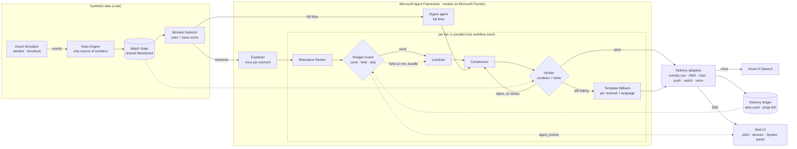

# Architecture

## Roles

| Component | Kind | Job | Why it is separate |
|---|---|---|---|
| Event Simulator | code | Seeded 90-minute match: possession chains, ratings, pressing, throw-ins, cards, subs, storylines | Reproducible demos and tests |
| Stats Engine | code | Possession, pass difficulty, xG, momentum, pressure index | The only source of numbers. Models never compute stats. |
| Moment Detector | code | Turns state changes into candidate moments with a base score and the facts that may be cited | Deterministic "what matters"; agents decide "how to say it" |
| Explainer | LLM agent | One neutral English explanation per moment, shared by all fans | Pay for the "why" once, not once per fan |
| Relevance Ranker | code | Scores the moment for this fan (club, player, focus metric, depth) | Simple arithmetic with visible reasons |
| Budget Guard | code | Send now, hold to bundle, or skip. Plans pings across the match and reserves for a goal and the digest. | A planner over the whole match: one agent writing text does this badly |
| Localizer | LLM agent | Fan's language, tone, slang and depth | Translation changes length and encoding, so it must happen before compression |
| Compressor | LLM agent | Fits the localized text to the channel's hard limit, in the target language | Optimises against a byte/segment budget |
| Verifier | code | Every number in the facts (any script's digits), every limit met (real GSM-7/UCS-2 segments) | Deterministic gate; drives the retry loop |
| Digest | LLM agent | Full-time recap sized to the fan's remaining budget | Different length/budget problem |
| Voice adapter | Azure AI Speech | Ogg/Opus voice note with real duration and size | Real media cost on the data meter |

## Coordination

- **Shared state:** the Match State (read by the Detector, Verifier and agents) and per-fan ledgers (read by the
  Budget Guard, written by delivery).
- **Handoffs:** each fan's chain is a Microsoft Agent Framework `WorkflowBuilder` graph. A dispatcher routes
  new moments to the Ranker, and released bundles and digests straight to the Localizer. The Guard's edge sends,
  or stops. The Verifier sends an immutable `Verified(job, retry)` message, so the retry edge can't race with
  later changes to the job.
- **Parallelism:** fans run concurrently per moment; moments run in order per match (an `asyncio.Queue`), so the
  ledger is consistent and playback never waits on a model.
- **Recovery:** every model call has an 8 s timeout and 2 retries with backoff. A Verifier rejection returns to the
  Compressor with the exact reason, up to twice, and a template takes over after that. Every step is an
  `agent_event` in the System panel.
- **Backends:** Azure OpenAI in Foundry (API key), a Foundry project (Entra ID), or a deterministic offline
  Agent Framework chat client that renders the same templates, so tests and keyless demos exercise the exact
  same agents and workflow.

## Data flow per moment

1. The simulator event is folded into the Match State, and the Detector emits a `Moment` with `facts`.
2. The Explainer writes the "why" once and the Verifier checks its numbers (falling back to a template).
3. For each fan, in parallel:
   - Ranker → Budget Guard (reason recorded). On `hold`, the moment waits up to 2 match-minutes to be bundled.
     A goal or strong moment takes any held moments along in the same ping.
   - Localizer → Compressor → Verifier (≤ 2 retries) → template fallback.
   - Delivery: voice synthesis, overlay cue or message object. It is sized, charged to the ledger, and streamed
     to the UI.
4. At full time, every fan's digest is sized to what is left in their budget.

## Deployment

One container: a Node stage builds the static Next.js export, and the Python stage serves it with FastAPI next
to the API and the SSE stream. It runs on Azure Container Apps (consumption plan, one replica because live
state is in memory). See `docs/deploy.md`.
